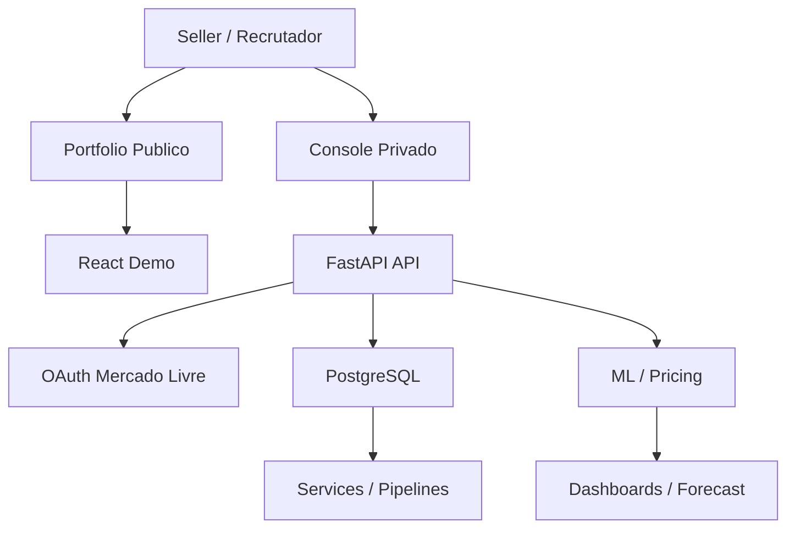
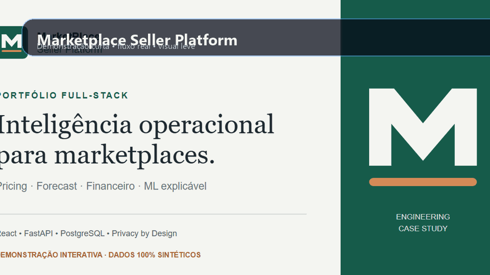
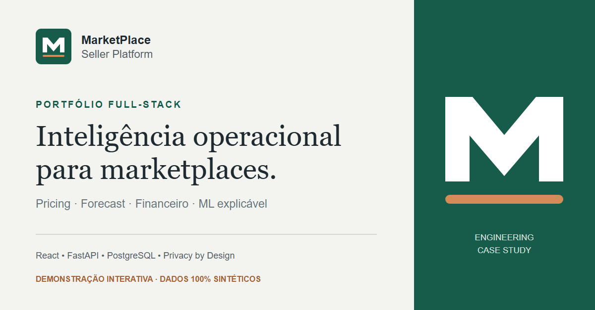

# Marketplace Seller Platform

**For recruiters:** [Technical case study — English / Español](docs/RECRUITER_CASE_STUDY.md)


## English overview

**Marketplace Seller Platform** is a data-driven marketplace operations project built with **Python, FastAPI, PostgreSQL, React and TypeScript**. Its architecture separates a public, synthetic-data portfolio demonstration from the authenticated operations console. The backend covers product management, pricing, marketplace integrations and analytical workflows, while `data_engineering/` contains data pipelines and Airflow DAGs.

**Engineering evidence:** GitHub Actions runs Python tests, migration and privacy checks, dependency audits, and TypeScript/frontend builds. Product updates restrict editable fields to protect record identity and tenant ownership.

- [Public demonstration](https://vinmedrado.github.io/marketplace-seller-platform/)
- [Architecture](docs/ARCHITECTURE.md) · [Security](docs/SECURITY.md) · [Privacy](PRIVACY.md)
- [CI results](https://github.com/vinmedrado/marketplace-seller-platform/actions/workflows/ci.yml)

> The public demo uses synthetic data. Passing CI verifies the configured automated checks; it is not a substitute for a full penetration test or production certification.

## Visao geral

Plataforma full-stack de inteligencia para sellers em marketplaces. O projeto combina React, FastAPI, PostgreSQL, pipelines de dados, pricing assistido, ML explicavel e privacidade by design.

## Problema

- Operacao dispersa entre planilhas, dashboards e APIs.
- Precificacao sem contexto de margem e concorrencia.
- Falta de separacao clara entre demo publica e console privado.
- Dificuldade para explicar o raciocinio por tras das recomendacoes.

## Solucao

O repositorio mantem duas experiencias:

- `frontend/`: console privado conectado a API e integracoes reais.
- `portfolio/`: demonstracao publica sem backend, usuarios, tokens ou dados reais.

[Abrir demonstracao publica](https://vinmedrado.github.io/marketplace-seller-platform/)

## Arquitetura



## Tecnologias

Python, FastAPI, React, PostgreSQL, SQLAlchemy, Alembic, Docker, Machine Learning, GitHub Pages.

## Funcionalidades

- Visao executiva com cenarios sinteticos e deterministas.
- Catalogo, pricing e concorrencia.
- War room e forecast.
- Reconciliacao financeira.
- ML explicavel com leitura de risco.
- Privacidade e LGPD by design.
- Demo publica isolada do backend privado.

## Demonstração

- Demo publica: [GitHub Pages](https://vinmedrado.github.io/marketplace-seller-platform/)
- Console privado: `frontend/`

## GIF



## Screenshots



## Como executar

### Demo publica

```bash
cd portfolio
npm ci
npm run build
npm run dev
```

### Console privado

```bash
cp .env.example .env
docker compose up --build
```

## Estrutura do projeto

```text
frontend/        console privado
portfolio/       demo publica
ui/              contratos HTTP FastAPI
services/        regras de negocio
pricing/         pricing e margem
ml/              pipeline de ML
data_engineering/ dados e agregacoes
integrations/    conectores externos
tests/           testes
docs/            documentacao
assets/demo/     screenshots e GIFs
```


## Qualidade, segurança e validação

Os fluxos de demonstração pública e console autenticado são independentes: a demo não requer tokens nem dados reais de vendedores. No backend, as rotas privadas exigem autenticação e operações de produtos são filtradas pelo identificador do cliente. Campos internos de produto (`id`, `cliente_id`, `ativo` e metadados) não podem ser sobrescritos pelo payload de atualização.

**Verificações automatizadas do CI** ([workflow](.github/workflows/ci.yml)):

- **Backend:** instalação, migrações Alembic, compilação, `pytest -q`, verificação de limpeza de privacidade e `pip_audit -r requirements.txt --no-deps`.
- **Demonstração pública:** `npm ci`, TypeScript, testes de privacidade/dados demonstrativos, build Vite e `npm audit`.
- **Console:** TypeScript, lint, testes, build e auditoria npm com limiar crítico.

Para executar o conjunto localmente, use o ambiente configurado conforme `.env.example` e os comandos do workflow. **Limitação:** a auditoria Python configurada com `--no-deps` não cobre toda a árvore transitiva; a auditoria do console usa limiar crítico. A aprovação do CI não representa uma avaliação de segurança exaustiva.


## Roadmap

- Consolidar mais evidencias visuais na demo publica.
- Evoluir previsoes e analises explicaveis.
- Manter separacao clara entre demo e console privado.

## Principais aprendizados

- Arquitetura em camadas
- APIs REST
- Docker
- PostgreSQL
- Machine Learning
- FastAPI
- React
- Clean Architecture
- Design de produto
- Automacoes
- Engenharia de Dados

## Licenca

MIT.
