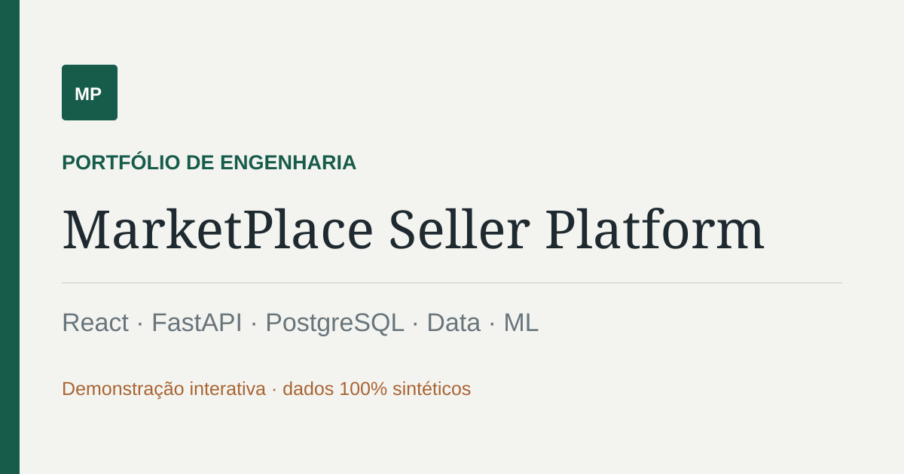
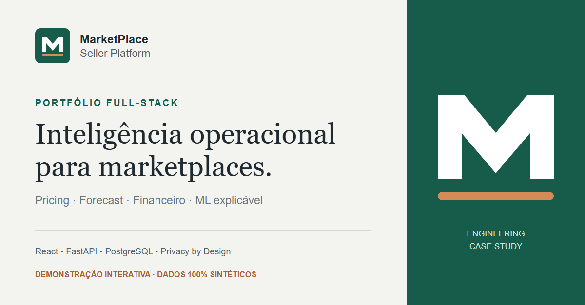

# Marketplace Seller Platform

Plataforma full-stack de inteligencia para sellers em marketplaces. O projeto combina React, FastAPI, PostgreSQL, pipelines de dados, pricing assistido, ML explicavel e privacidade by design.

O repositorio contem duas experiencias separadas:

- `frontend/`: console privado conectado a API e integracoes reais.
- `portfolio/`: demonstracao publica sem backend, usuarios, tokens ou dados reais.

[Abrir demonstracao publica](https://vinmedrado.github.io/marketplace-seller-platform/)

## Visao geral

A proposta e reduzir friccao operacional em rotinas de marketplace: precificacao, analise de concorrencia, forecast, reconciliacao, ML e leitura executiva do negocio.

## Problema que resolve

- Operacao dispersa entre planilhas, APIs, relatórios e decisoes manuais.
- Precificacao sem contexto de margem, demanda e concorrencia.
- Falta de separacao entre demo publica e ambiente privado.
- Dificuldade de explicar o raciocinio por tras das recomendacoes.

## Arquitetura

```text
portfolio/        demo publica em GitHub Pages
frontend/         console privado e integracoes
ui/               contratos HTTP FastAPI
services/         regras de negocio e inteligencia
pricing/          calculo de preco e guardrails
ml/               features, treino e inferencia
data_engineering/  raw, staging, marts e feature store
integrations/     OAuth e Mercado Livre
tests/            testes automatizados
```

## Screenshots




## Funcionalidades

- Visao executiva com cenarios sinteticos e deterministas.
- Catálogo, pricing e concorrencia.
- War room e forecast.
- Reconciliacao financeira.
- ML explicavel com leitura de risco.
- Privacidade e LGPD por design.
- Demo publica isolada do backend privado.

## Tecnologias

Python, FastAPI, React, PostgreSQL, SQLAlchemy, Alembic, Docker, Machine Learning, Python packaging, GitHub Pages.

## Como executar

### Demo publica

```bash
cd portfolio
npm ci
npm run build
npm run dev
```

### Console privado

```bash
cp .env.example .env
docker compose up --build
```

## Estrutura do projeto

```text
frontend/          console privado
portfolio/         demo publica
ui/                rotas FastAPI
services/          casos de uso
pricing/           pricing e margem
ml/                pipeline de ML
data_engineering/  dados e agregacoes
integrations/      conectores externos
tests/             testes
docs/              documentacao
```

## Roadmap

- Consolidar mais evidencias visuais na demo publica.
- Evoluir previsoes e analises explicaveis.
- Manter separacao clara entre demo e console privado.

## Licenca

MIT.
