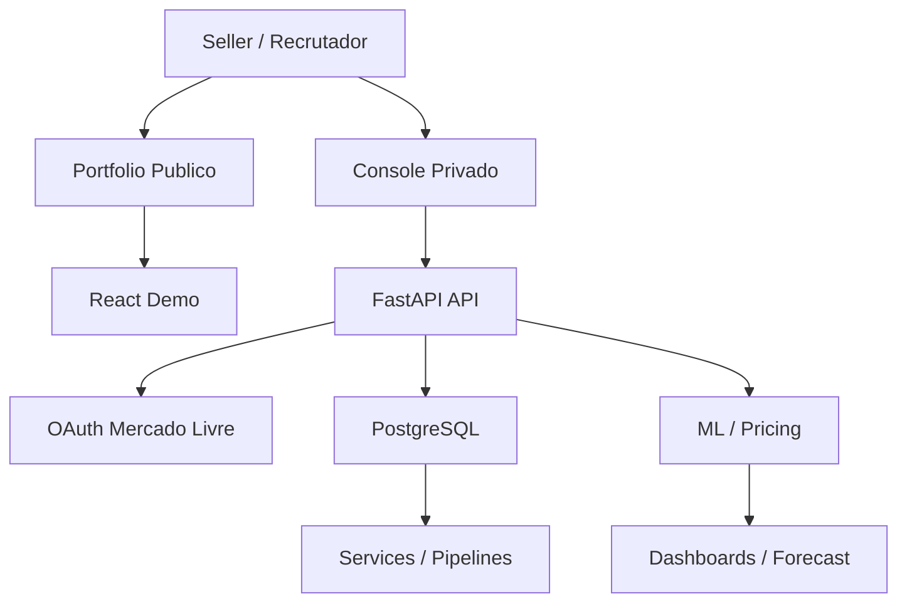

# Marketplace Seller Platform

## Visao geral

Plataforma full-stack de inteligencia para sellers em marketplaces. O projeto combina React, FastAPI, PostgreSQL, pipelines de dados, pricing assistido, ML explicavel e privacidade by design.

## Problema

- Operacao dispersa entre planilhas, dashboards e APIs.
- Precificacao sem contexto de margem e concorrencia.
- Falta de separacao clara entre demo publica e console privado.
- Dificuldade para explicar o raciocinio por tras das recomendacoes.

## Solucao

O repositorio mantem duas experiencias:

- `frontend/`: console privado conectado a API e integracoes reais.
- `portfolio/`: demonstracao publica sem backend, usuarios, tokens ou dados reais.

[Abrir demonstracao publica](https://vinmedrado.github.io/marketplace-seller-platform/)

## Arquitetura



## Tecnologias

Python, FastAPI, React, PostgreSQL, SQLAlchemy, Alembic, Docker, Machine Learning, GitHub Pages.

## Funcionalidades

- Visao executiva com cenarios sinteticos e deterministas.
- Catalogo, pricing e concorrencia.
- War room e forecast.
- Reconciliacao financeira.
- ML explicavel com leitura de risco.
- Privacidade e LGPD by design.
- Demo publica isolada do backend privado.

## Demonstração

- Demo publica: [GitHub Pages](https://vinmedrado.github.io/marketplace-seller-platform/)
- Console privado: `frontend/`

## GIF

TODO: gravar um GIF curto com a abertura da demo publica, navegacao pela visao executiva e uma tela de pricing/forecast.

## Screenshots


## Como executar

### Demo publica

```bash
cd portfolio
npm ci
npm run build
npm run dev
```

### Console privado

```bash
cp .env.example .env
docker compose up --build
```

## Estrutura do projeto

```text
frontend/        console privado
portfolio/       demo publica
ui/              contratos HTTP FastAPI
services/        regras de negocio
pricing/         pricing e margem
ml/              pipeline de ML
data_engineering/ dados e agregacoes
integrations/    conectores externos
tests/           testes
docs/            documentacao
assets/demo/     screenshots e GIFs
```

## Roadmap

- Consolidar mais evidencias visuais na demo publica.
- Evoluir previsoes e analises explicaveis.
- Manter separacao clara entre demo e console privado.

## Principais aprendizados

- Arquitetura em camadas
- APIs REST
- Docker
- PostgreSQL
- Machine Learning
- FastAPI
- React
- Clean Architecture
- Design de produto
- Automacoes
- Engenharia de Dados

## Licenca

MIT.
